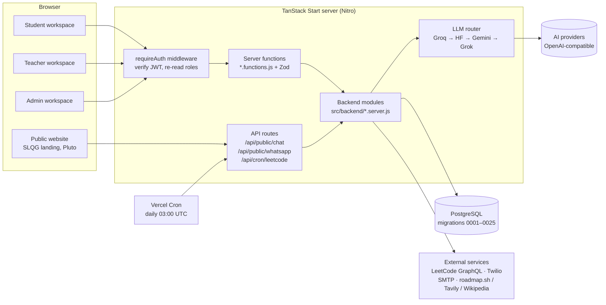
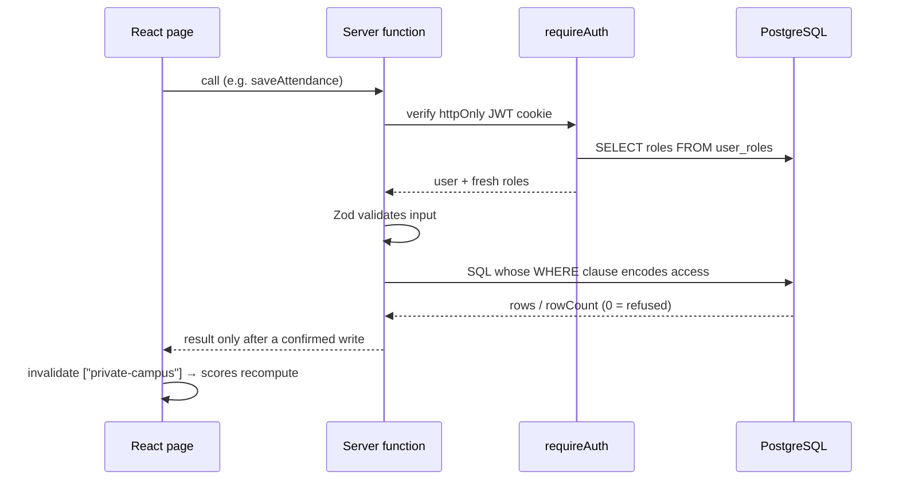

# SLQG — Student Learning, Quality & Growth

**A student success intelligence platform.** SLQG (shown in the app as **BIB InsightIQ**) brings seven campus data sources together under one student identity, turns them into an explainable **Success Score** and risk flags, predicts placement and exam outcomes, and gives students, teachers and administrators the tools to act on them.

Built by **TEAM BIB (Biryani Intelligence Bureau)** for the **HacXLerate Smart Campus Analytics** challenge.

> _Turning campus data into student success._

For every student the platform answers three questions:

1. **Who needs help?** An explainable 0–100 Success Score with clear bands.
2. **Why?** Points-based Academic and Placement risk flags with the exact signals that fired.
3. **What should we do next?** Recommended actions, an AI coach, and mentor interventions with an owner and a follow-up date.

---

## Contents

1. [Highlights](#highlights)
2. [Architecture](#architecture)
3. [Features](#features)
   - [Public website](#public-website)
   - [Accounts and access](#accounts-and-access)
   - [Student workspace](#student-workspace)
   - [Teacher workspace](#teacher-workspace)
   - [Administrator workspace](#administrator-workspace)
   - [AI features](#ai-features)
   - [Integrations](#integrations)
4. [How the scores work](#how-the-scores-work)
5. [Security model](#security-model)
6. [Getting started](#getting-started)
7. [Configuration](#configuration)
8. [Deployment](#deployment)
9. [Testing](#testing)
10. [Project structure](#project-structure)
11. [Commands](#commands)
12. [Further documentation](#further-documentation)
13. [Limits and honest caveats](#limits-and-honest-caveats)

---

## Highlights

|                              |                                                                                                               |
| ---------------------------- | ------------------------------------------------------------------------------------------------------------- |
| **No demo mode**             | Every page runs on real accounts and PostgreSQL data. Missing data is shown as missing, never as zero.        |
| **Explainable by design**    | Every score shows its weights; every risk flag lists signal → value → rule → points.                          |
| **Server-enforced access**   | Roles are re-read from the database on every request and checked in SQL. Hiding a menu is never the security. |
| **Grounded AI**              | The Analytics Copilot answers from tool results and returns the evidence tables behind every answer.          |
| **Tamper-evident audit**     | Complaint history is a SHA-256 hash chain that detects any edit to past events.                               |
| **Predictions with honesty** | Fixed, published weights plus cross-validated regression models that report accuracy, F1 and ranges.          |

---

## Architecture

### System overview



### How a protected request flows



### Technology

| Layer         | Technology                                                                                      |
| ------------- | ----------------------------------------------------------------------------------------------- |
| Framework     | TanStack Start (React 19, file-based routing, server functions), Vite                           |
| UI            | Tailwind CSS 4, shadcn/ui (Radix), Recharts, AI Elements, Lucide icons; Inter and Manrope fonts |
| Data fetching | TanStack Query (one shared `["private-campus"]` query for record data)                          |
| Database      | PostgreSQL via `pg`, numbered SQL migrations; PGlite (in-memory Postgres) for tests             |
| Auth          | bcrypt (cost 12) + HS256 JWT (`jose`) in an httpOnly cookie, 12-hour sessions                   |
| Validation    | Zod on every server-function input                                                              |
| AI            | Vercel AI SDK (`ai`, `@ai-sdk/openai-compatible`) with any OpenAI-compatible provider           |
| Hosting       | Nitro output for Vercel, or `npm start` as a Node.js server                                     |
| Language      | Plain JavaScript (the only TypeScript file is the generated `src/routeTree.gen.ts`)             |

### Design rules

These come from `AGENTS.md` and shape the codebase:

- **The server decides.** Record access is enforced in authenticated server functions with SQL that checks the caller's roles.
- **Roles come from the database**, never from the token, so a role change applies immediately.
- **Writes are confirmed** before success is returned, then the shared campus query is invalidated so derived scores refresh.
- **Missing is not zero.** Components without data are left out and the remaining weights rescaled.
- **AI stays on the server.** Prompts, conversation handling and provider keys never reach the browser.

---

## Features

### Public website

| Feature                     | How it works                                                                                                                                                                                                                                                                                                                                                                      |
| --------------------------- | --------------------------------------------------------------------------------------------------------------------------------------------------------------------------------------------------------------------------------------------------------------------------------------------------------------------------------------------------------------------------------- |
| **SLQG landing page** (`/`) | Interactive page with a cinematic hero, an auto-playing phone showcase (pauses off-screen and for reduced motion), a seven-domain band, a **Studio** of illustrative student scenarios whose score is computed live from the real weights, a formula toggle, role tabs, a journey, FAQ and call to action. Its stylesheet is scoped under `.slqg` so it cannot affect the portal. |
| **Product pages**           | `/solution`, `/benefits`, `/privacy`, `/contact` (contact form is rate-limited and stored for administrators).                                                                                                                                                                                                                                                                    |
| **Pluto (public)**          | A floating assistant that answers only questions about the product. It has no access to student records.                                                                                                                                                                                                                                                                          |
| **Smooth scrolling**        | Site-wide, disabled for users who prefer reduced motion. All links open in the same tab.                                                                                                                                                                                                                                                                                          |

### Accounts and access

| Feature                 | How it works                                                                                                                                                                                                                         |
| ----------------------- | ------------------------------------------------------------------------------------------------------------------------------------------------------------------------------------------------------------------------------------ |
| **No self sign-up**     | Administrators register students and teachers (one at a time or from a CSV) under **Login credentials** (`/portal/access`). A strong password is generated and emailed, or shown once to the administrator when email is not set up. |
| **First administrator** | `npm run db:create-admin -- you@college.edu "Your Name"` prints a one-time password.                                                                                                                                                 |
| **Login**               | One login page for all workspaces, with a self-hosted text captcha (signed, single-use token holding only a keyed hash of the answer). Choosing a workspace never grants access; the database does.                                  |
| **Forgot password**     | Works without email: the person asks on the login page, an administrator approves, and the person sets a new password on the same page. Each approval works once, and the page answers the same for unknown emails.                  |
| **Change password**     | A signed-in request that an administrator approves; the old password stays valid until then.                                                                                                                                         |
| **Roles**               | `student`, `faculty` (teacher), `admin`. A teacher or administrator is never also a student.                                                                                                                                         |

### Student workspace

White sidebar layout with: **Overview, Academics, Attendance Planner, Predictive Risk & AI, Learning & LMS, Placement & Careers, Skills & Coding, Personalised AI Lessons, AI Interview**, plus Notifications, Announcements, Learning path, Chats, Engagement, Feedback and Profile. A global search (Ctrl/Cmd + K) jumps to any feature.

| Feature                                          | How it works                                                                                                                                                                                                                                                                                                                                                                                                                                                                                                                                                                           |
| ------------------------------------------------ | -------------------------------------------------------------------------------------------------------------------------------------------------------------------------------------------------------------------------------------------------------------------------------------------------------------------------------------------------------------------------------------------------------------------------------------------------------------------------------------------------------------------------------------------------------------------------------------- |
| **Overview dashboard**                           | Greeting with the top alert; KPI row (Success Score ring, CGPA, attendance, LMS, alerts); an **SGPA velocity** chart; a **Cohort Competency Vector** comparing you with your branch and semester as percentiles (aggregates only, withheld for cohorts under 5 so no classmate can be identified); directives and a tabbed workspace.                                                                                                                                                                                                                                                  |
| **Academics**                                    | Marks, SGPA/CGPA computed from recorded marks and syllabus credits, backlogs and re-exam status, semester history, printable result.                                                                                                                                                                                                                                                                                                                                                                                                                                                   |
| **Attendance Planner**                           | Targets of 75/80/85/90%, classes still to attend, classes you can miss, what-if projections, an attend-or-skip table per subject, and the day-by-day log of every class marked.                                                                                                                                                                                                                                                                                                                                                                                                        |
| **Predictive Risk & AI**                         | Live attention cards; risk level with reasons; **placement prediction** (LeetCode 25, Aptitude 20, CGPA 20, Mock interviews 20, Resume 15) with a 12-week projection and "sections to improve first"; **result prediction** per subject (mid exams 35, continuous assessment 25, attendance 25, teacher rating 15) and a predicted SGPA; **learned-model forecasts** with 90% ranges, confidence and benchmark tables; a recommended action plan; the **prediction coach**; rule-based risk breakdown; and the Success Score make-up. Export to print/PDF and one-click recalculation. |
| **Learning & LMS**                               | Six units per subject with syllabus topics, materials and links, lesson completion, one assignment per unit with deadlines, text/file submissions, grades and remarks. Progress feeds the score.                                                                                                                                                                                                                                                                                                                                                                                       |
| **Placement & Careers**                          | Drives with criteria; a Passed / Not met / Unknown checklist; applying re-checks eligibility on the server (unknown is never eligible). Drives have ordered **selection rounds** (e.g. Aptitude → Technical → HR) with per-round results and filters. Role match lists skill gaps; an ATS checker scores the resume.                                                                                                                                                                                                                                                                   |
| **Skills & Coding**                              | Teacher-recorded assessments (score = mean of the latest three), history, weak areas and practice suggestions.                                                                                                                                                                                                                                                                                                                                                                                                                                                                         |
| **LeetCode integration**                         | Link a username (validated against LeetCode). Solved counts, ranking and contest rating feed the placement prediction; a daily job refreshes stats, records contest results and notifies you about contests in the next 24 hours. Teachers see it on your profile.                                                                                                                                                                                                                                                                                                                     |
| **Personalised AI Lessons**                      | A 20-question learning-style profile, then narrated **board lessons** generated for any topic in your subjects, with a quiz and a **Boss Battle** game.                                                                                                                                                                                                                                                                                                                                                                                                                                |
| **AI Interview**                                 | Questions written from your resume; answer by voice or typing, with a code editor for coding questions (code is reviewed, never run). **Exam mode:** full screen, and leaving the screen gives warnings; the third ends the interview and tells your teacher. A **Finish interview** button lets you end at any time after a confirmation. You get a graded, downloadable report.                                                                                                                                                                                                      |
| **Engagement**                                   | Events, clubs, hackathons and certifications; only teacher-verified activities count.                                                                                                                                                                                                                                                                                                                                                                                                                                                                                                  |
| **Feedback**                                     | Weekly satisfaction, notes to your mentor, and **confidential complaints** visible only to you and administrators.                                                                                                                                                                                                                                                                                                                                                                                                                                                                     |
| **Chats, notifications, announcements, profile** | Section chat rooms and teacher-approved private chats with attachments; a notification bell (each situation stored once); announcements; profile with contact links and LeetCode.                                                                                                                                                                                                                                                                                                                                                                                                      |

### Teacher workspace

Teachers see **only the students assigned to them** (plus every student taking a subject they teach, for attendance). It uses the same blue-to-navy palette and fonts as the student workspace.

| Feature                              | How it works                                                                                                                                                                                                                                     |
| ------------------------------------ | ------------------------------------------------------------------------------------------------------------------------------------------------------------------------------------------------------------------------------------------------ |
| **My students**                      | Filterable lists, comparison of up to three students, and a live student profile (score breakdown, risk, attendance, LMS, skills, placement, engagement, LeetCode, predictions, AI interview results).                                           |
| **Attendance**                       | Marks only the **subjects the teacher teaches** (assigned by an administrator), for every student taking that subject. Everyone starts as present; re-marking a class corrects it rather than double-counting, and absent students are notified. |
| **Timetable**                        | Shows and edits only the subjects the teacher teaches.                                                                                                                                                                                           |
| **Results, LMS, Skills, Engagement** | Enter marks, configure units and assignments, grade submissions, record assessments, post and verify activities.                                                                                                                                 |
| **Placement**                        | Post drives with criteria and rounds; move applicants through rounds.                                                                                                                                                                            |
| **Interventions**                    | Support actions with reason, action, priority, owner and follow-up date; status and outcome tracking.                                                                                                                                            |
| **Predictions agent**                | Predicts every student in scope, compares with the last run, raises alerts and builds a watchlist; one click turns a recommended action into an intervention.                                                                                    |
| **Analytics Copilot**                | Natural-language questions answered with evidence (see [AI features](#ai-features)).                                                                                                                                                             |

### Administrator workspace

Everything a teacher has across **all** students, plus:

| Feature                                         | How it works                                                                                                                                                     |
| ----------------------------------------------- | ---------------------------------------------------------------------------------------------------------------------------------------------------------------- |
| **Login credentials**                           | Register students and teachers singly or by CSV; approve forgot-password and change-password requests.                                                           |
| **People & roles / Teachers / Assign students** | Grant or remove roles (you cannot remove your own admin role), see teacher workload, **assign the subjects each teacher teaches**, and link students to mentors. |
| **Student records**                             | Create and edit records, CSV import with validation, data-quality checks, and an audit log of every change.                                                      |
| **Attendance**                                  | **View-only** for every subject; only the subject's teacher can mark it. The administrator can still build the campus timetable.                                 |
| **Admin analytics**                             | Branch / year / cohort / band filters drive every chart; click a band or risk count to list students; coverage per data source; intervention progress.           |
| **Complaints**                                  | Review confidential complaints, set severity, assign, resolve with evidence, and **verify the audit chain**.                                                     |
| **Predictions**                                 | Train the learned models from live data; every run is kept with its metrics.                                                                                     |
| **Messages**                                    | Contact-form messages and requests.                                                                                                                              |

### AI features

| Feature                                   | Who              | How it is grounded                                                                                                                                                                                                                                                                                                                                                                                                                                           |
| ----------------------------------------- | ---------------- | ------------------------------------------------------------------------------------------------------------------------------------------------------------------------------------------------------------------------------------------------------------------------------------------------------------------------------------------------------------------------------------------------------------------------------------------------------------ |
| **Analytics Copilot** (`/portal/copilot`) | Teachers, admins | The model may call only five fixed, read-only, Zod-validated tools: `cohort_summary`, `find_students`, `score_drivers`, `student_profile`, `support_actions`. It never writes SQL and only reaches records the caller may see. Each tool call is recorded as an **evidence table** (E1, E2, …) of the exact rows used and returned beside the answer; citations like `[E1, E3]` open and highlight their table. Rate-limited to 20 questions per 10 minutes. |
| **Pluto (signed in)**                     | Everyone         | A plain-code router fetches the data first (limited in SQL to the caller's role), so the model only words the answer, and a plain-wording fallback still works with no model.                                                                                                                                                                                                                                                                                |
| **Prediction coach**                      | Students         | Re-predicts, researches the target role (roadmap.sh, optional Tavily search, Wikipedia; cached for a week), ranks criteria by score gain × market importance, and builds a checklist plan with cited sources.                                                                                                                                                                                                                                                |
| **AI Lessons / AI Interview**             | Students         | Prompts and output validation are server-side; output must match a schema.                                                                                                                                                                                                                                                                                                                                                                                   |

**Model routing.** `src/backend/llm.server.js` tries each configured provider in order and skips one that fails (quota, rejected key or retired model) for a while: **Groq** (`GROQ_API_KEY`) → **Hugging Face** (`HF_API_KEY`) → **Gemini** (`LLM_API_KEY`: `LLM_MODEL`, then the `gemini-flash-lite-latest` / `gemini-flash-latest` aliases). The Copilot uses Groq → Gemini → **Grok** (`GROK_API_KEY`) and shows the provider's real failure reason (never the key).

### Integrations

| Integration           | What it does                                                                                                                                                                                                                                                                                                       |
| --------------------- | ------------------------------------------------------------------------------------------------------------------------------------------------------------------------------------------------------------------------------------------------------------------------------------------------------------------ |
| **LeetCode**          | Public GraphQL; stats and contest history stored per student; daily refresh via `/api/cron/leetcode` (Bearer `CRON_SECRET`, scheduled in `vercel.json`).                                                                                                                                                           |
| **WhatsApp (Twilio)** | Signed webhook `/api/public/whatsapp`; sign in inside the chat (5 wrong passwords lock the number for 15 minutes); commands such as `score`, `attendance`, `marks`, `timetable` (students) and `students`, `risk`, `low` (staff), with the same permissions as the site. See [docs/WHATSAPP.md](docs/WHATSAPP.md). |
| **Email (SMTP)**      | Sends generated login passwords when configured.                                                                                                                                                                                                                                                                   |

---

## How the scores work

### Success Score

| Component                             | Weight |
| ------------------------------------- | ------ |
| Academics (CGPA × 10)                 | 30%    |
| Attendance                            | 20%    |
| LMS completion                        | 15%    |
| Engagement (verified activities only) | 10%    |
| Skills (mean of latest assessments)   | 10%    |
| Placement readiness                   | 15%    |

**Bands:** 80+ **On Track** · 65–79 **Monitor** · 50–64 **Needs Attention** · below 50 **High Priority**. Missing components are excluded and the rest rescaled. Weights live in `src/lib/types.js`, calculations in `src/lib/scoring.js`. Feedback adds context but is not scored.

### Risk flags

`src/lib/risk-flags.js` holds two points tables (signal, threshold, points):

- **Academic risk:** backlogs, low CGPA, SGPA drop, low attendance, subjects under 75%, low LMS lessons/assignments → High ≥ 5 points, Medium ≥ 2.
- **Placement risk:** low readiness, weak aptitude or coding, weak resume, no mock interviews, incomplete assessments, no certifications or hackathons → High ≥ 6 points, Medium ≥ 3.

A signal with no data adds no points and is listed as "insufficient data". Any **High** flag stops a student being shown as On Track.

### Predictions

Fixed, published weights for placement and result predictions, plus three ridge-regression models (final subject marks, next-semester SGPA, mock-interview score) trained on the platform's own records and **cross-validated (5 folds, grouped by student)**. Accuracy, precision, recall and F1 are measured on the decisions made from each prediction and compared with simple baselines. Details in [docs/PREDICTIONS.md](docs/PREDICTIONS.md).

### Tamper-evident complaint chain

Every complaint event (`CREATED`, `ASSIGNED`, `SEVERITY_OVERRIDE`, `STATUS_CHANGED`, `REOPENED`, `RESOLUTION_EVIDENCE`) becomes a block in `chain_blocks`. Each block stores the previous block's hash, and its own hash is **SHA-256** over the previous hash, event, actor and a canonical sorted-key JSON payload. **Verify integrity** recomputes the chain and names the first block that no longer matches. It is tamper-_evident_ within one database, not a distributed blockchain.

---

## Security model

- Passwords hashed with bcrypt (cost 12); sessions are HS256 JWTs (12 hours) in an httpOnly, SameSite=Lax cookie, Secure in production. No token in browser storage.
- Roles re-read from `user_roles` on every request; access is written into the SQL itself, and a zero row count is treated as a refusal.
- Teachers see only their assigned students and the subjects they teach; administrators can view attendance but not mark it; confidential complaints are hidden from teachers.
- Captcha on login; rate limits on login, password requests, the assistant, feedback and the Copilot (in-memory per instance; add platform rate limiting such as Vercel Firewall for stronger protection).
- Uploaded files are stored in PostgreSQL (≤ 3 MB, documents and images only) and only ever offered as downloads.
- Public endpoints check origin and body size; the WhatsApp webhook verifies Twilio's signature; the cron route requires `CRON_SECRET`.
- Secrets (`DATABASE_URL`, `JWT_SECRET`, AI keys, `CRON_SECRET`, `TWILIO_AUTH_TOKEN`) live only in the environment, never in the repository.

---

## Getting started

### Prerequisites

- Node.js 22 or later
- PostgreSQL: local (Docker Compose provided) or hosted (for example [Neon](https://neon.tech), using the pooled connection string)

### Install and run

```bash
git clone https://github.com/Lakshith-P/BIB-CampusPulse-AI.git
cd BIB-CampusPulse-AI
npm install
cp .env.example .env          # Windows PowerShell: Copy-Item .env.example .env
```

Fill in `.env` (see [Configuration](#configuration)), then:

```bash
docker compose up -d          # optional: local PostgreSQL
npm run db:migrate            # apply every migration
npm run db:check              # expect "Schema OK"
npm run db:create-admin -- you@college.edu "Your Name"   # prints a one-time password
npm run dev                   # open the printed address
```

Sign in as the administrator, register teachers and students under **Login credentials**, assign subjects to teachers on **Teachers**, and link students to mentors under **Assign students**. For local development only, `npm run db:seed-demo` fills the database with sample data.

---

## Configuration

Copy `.env.example` to `.env` for local use. On a host such as Vercel, set the same variables in the project settings; the local `.env` file is not deployed.

| Variable                                      | Required     | Purpose                                                                                  |
| --------------------------------------------- | ------------ | ---------------------------------------------------------------------------------------- |
| `DATABASE_URL`                                | Yes          | PostgreSQL connection string (pooled on serverless hosts).                               |
| `JWT_SECRET`                                  | Yes          | 32+ random characters for session signing.                                               |
| `DATABASE_SSL`, `DATABASE_POOL_MAX`           | No           | Force TLS on/off; pool size (default 3 on Vercel, 10 elsewhere).                         |
| `SMTP_URL`, `APP_URL`, `MAIL_FROM`            | Optional     | Email delivery of generated passwords.                                                   |
| `GROQ_API_KEY`, `GROQ_MODEL`                  | Optional     | Groq, tried first by every AI feature (default `llama-3.3-70b-versatile`).               |
| `LLM_API_KEY`, `LLM_MODEL`, `LLM_BASE_URL`    | For AI       | Main OpenAI-compatible provider (Gemini by default; falls back to the "latest" aliases). |
| `HF_API_KEY`                                  | Optional     | Hugging Face Inference router.                                                           |
| `GROK_API_KEY`, `GROK_MODEL`, `GROK_BASE_URL` | Optional     | Copilot fallback (default `grok-4`, `https://api.x.ai/v1`).                              |
| `TAVILY_API_KEY`                              | Optional     | Live web research for the prediction coach.                                              |
| `CRON_SECRET`                                 | For the cron | Authorises `/api/cron/leetcode`.                                                         |
| `TWILIO_AUTH_TOKEN`, `TWILIO_WEBHOOK_URL`     | For WhatsApp | Verifies the Twilio webhook.                                                             |

Generate a secret with:

```bash
node -e "console.log(require('crypto').randomBytes(48).toString('base64url'))"
```

---

## Deployment

1. **Database:** create a PostgreSQL database (for Neon, enable connection pooling and copy the `-pooler` connection string).
2. **Schema:** with `DATABASE_URL` pointing at it, run `npm run db:migrate` and `npm run db:check`. Repeat `db:migrate` whenever a new file appears in `db/migrations`.
3. **Vercel:** import the repository (framework TanStack Start or Other, build `npm run build`, Node 22+), and add the environment variables above for Production and Preview.
4. **Cron:** keep `vercel.json` (daily LeetCode sync at 03:00 UTC) and set `CRON_SECRET`.
5. **First admin:** run `npm run db:create-admin` against the production database.
6. **Verify:** the landing page loads, you can sign in, and Pluto and the Copilot answer.

| Symptom                                              | Likely cause                                                            |
| ---------------------------------------------------- | ----------------------------------------------------------------------- |
| `DATABASE_URL is not set` / `JWT_SECRET must be set` | Variable missing on the host; add it and redeploy.                      |
| A page shows a missing-table error                   | Migrations not applied to that database.                                |
| AI features say "not configured"                     | No `GROQ_API_KEY` / `LLM_API_KEY` on the host.                          |
| AI features return a provider error (HTTP 404/429)   | Retired model or quota; set `LLM_MODEL` or add Groq/Grok as a fallback. |
| Too many connections                                 | Use the pooled connection string or lower `DATABASE_POOL_MAX`.          |

---

## Testing

```bash
npm test
```

Vitest with **54 test files / 420+ tests**:

- `src/test/db/*.test.js` run the **real migrations on in-memory PostgreSQL (PGlite)** and check permissions and behaviour end to end: attendance and subject teachers, registration and password approvals, LMS, placement and rounds, LeetCode, the complaint chain (including tamper detection), cohort privacy, predictions and ML models, interviews and the Copilot's scope and evidence.
- Component tests render and click real pages: score breakdown, attendance planner, dashboard, Predictive Risk, interview proctoring and the Finish button, landing loader and more.
- Pure-logic tests cover scoring boundaries, risk flags, attendance maths, regression metrics, drive filters, CSV parsing and interview reports.

---

## Project structure

```
db/migrations/        Numbered SQL schema (0001 … 0025)
scripts/              migrate, check, create-admin, set-role, seed-demo, whatsapp-chat
src/backend/          Server-only modules, one per feature (*.server.js): access, auth,
                      attendance, lms, placement, predictions, ml-models, copilot, chain,
                      leetcode, interview, ai-lessons, llm router, registration, ...
src/lib/              Shared logic (scoring, risk-flags, prediction, linreg, campus-derive)
                      and server functions (*.functions.js)
src/components/
  landing/            SLQG landing page and its scoped stylesheet
  portal/             Workspace shells and every portal page
  student-profile/    Live student profile used by staff
  ai-elements/        Chat UI building blocks
  ui/                 shadcn/ui primitives
src/routes/           File routes; _authenticated/portal.* is the signed-in portal; api.* routes
src/test/             Vitest suites (db/ uses PGlite)
docs/                 Focused documentation (see below)
```

`src/routeTree.gen.ts` is generated by TanStack Router; never edit it by hand.

---

## Commands

| Command                                       | Purpose                                                     |
| --------------------------------------------- | ----------------------------------------------------------- |
| `npm run dev`                                 | Development server                                          |
| `npm run build` / `npm start`                 | Production build / run it with Node                         |
| `npm test` / `npm run lint`                   | Tests / ESLint                                              |
| `npm run db:migrate`                          | Apply pending migrations                                    |
| `npm run db:check`                            | Verify the connection and schema                            |
| `npm run db:create-admin -- <email> "<name>"` | Create the first administrator (or reset an admin password) |
| `npm run db:set-role -- <email> <role>`       | Grant a role (`--revoke` to remove)                         |
| `npm run db:seed-demo`                        | Development sample data only                                |
| `npm run whatsapp:chat`                       | Try the WhatsApp assistant from the terminal                |

---

## Further documentation

| Document                                                       | Contents                                     |
| -------------------------------------------------------------- | -------------------------------------------- |
| [docs/PROJECT_DOCUMENTATION.md](docs/PROJECT_DOCUMENTATION.md) | Every feature in depth, with how it works    |
| [docs/architecture.md](docs/architecture.md)                   | Stack, request flow, sessions, rate limiting |
| [docs/data-model.md](docs/data-model.md)                       | Database tables and the student record       |
| [docs/server-functions.md](docs/server-functions.md)           | What the server exposes and who may call it  |
| [docs/SUCCESS_SCORE.md](docs/SUCCESS_SCORE.md)                 | The Success Score in detail                  |
| [docs/PREDICTIONS.md](docs/PREDICTIONS.md)                     | Predictions, agents and the learned models   |
| [docs/WHATSAPP.md](docs/WHATSAPP.md)                           | WhatsApp assistant setup                     |
| [docs/development.md](docs/development.md)                     | Working on the code                          |

---

## Limits and honest caveats

- **Weights are published, not learned from outcomes.** There is no history of past placements or exam outcomes to learn from; treat scores as a transparent early-warning estimate. The learned models report their cross-validated accuracy.
- **Notifications** are generated when people use the app (LeetCode contest alerts come from the daily job).
- **Rate limits** are per server instance.
- **AI answers can be wrong.** The Copilot shows its evidence so a person can check, and student data is sent to the configured AI provider; review this against your privacy policy.
- **Two teachers of the same subject** currently both see every student taking it; a per-section split is a possible next step.
- **The audit chain** detects tampering but is not distributed.

---

_Explainable insights. Human-led support. Built by TEAM BIB._
